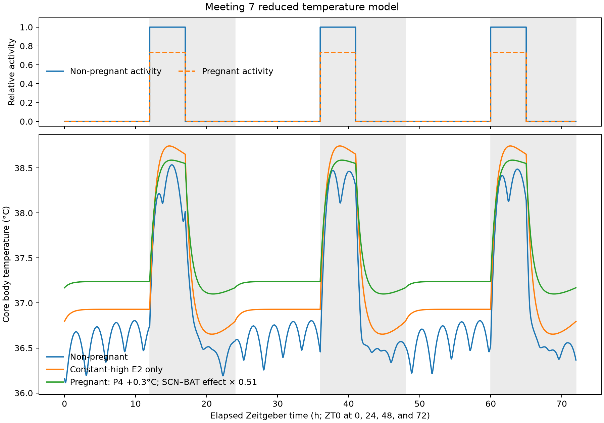

# Meeting 7 temperature model: constants and provenance

This document covers the temperature subsystem in [`MODEL.py`](MODEL.py). It
does **not** document the endocrine-model constants. Values are
classified so that a literature measurement is not confused with a digitized
figure estimate, a fitted coefficient, or a modeling choice.

## Provenance labels

- **Direct**: a number explicitly reported in a source.
- **Figure-derived**: estimated from a published graph and therefore less
  precise than a tabulated value.
- **Calibrated**: fitted to a target data series rather than copied from a
  paper.
- **Derived**: arithmetic combination of other constants.
- **Modeling choice**: a numerical, waveform, or comparison assumption; there
  is no paper that directly reports this exact value.

## Temperature equation implemented in the code

Let `T` be core temperature, `T_a = 22 °C`,
`C_b = 0.018379 kcal/°C`, and
`G = 0.02425 kcal/(h·°C)`. The code uses

```text
dT/dt = B_OVX,mean / C_b
      + (0.11 B_OVX,mean / C_b) H_heat(E2)
      + m_BAT (G / C_b)(0.3 °C) C_SCN(ZT)
      + m_activity (G / C_b)(1.9 °C) Activity(t)
      + m_P4 (G / C_b)(0.3 °C)
      - (G / C_b)(T - T_a)
      + (0.0275 G / C_b) H_loss(E2)(T - T_a)
```

where

```text
ZT(t)          = t mod 24, with ZT0 = lights on and ZT12 = lights off
B_OVX,mean     = 0.32 kcal/h
H_heat(E2)     = E2^1.41 / (9.0^1.41 + E2^1.41)
H_loss(E2)     = E2^1.83 / (7.49^1.83 + E2^1.83)
C_SCN(ZT)      = 0 before ZT12; otherwise cos[2 pi (ZT - 7)/24]
Activity(t)    = 1 during ZT12-ZT17 and 0 otherwise
```

The ordinary nonpregnant and constant-high-E2-only runs use `m_P4 = 0`.
The pregnancy comparison uses `m_BAT = 0.51`, `m_activity = 0.7322`, and
`m_P4 = 1`. Thus progesterone is a separate pregnancy-comparison input; it is
not inserted into the cycling-E2 endocrine equation or either E2 Hill curve.

## Final recalibration and time series

The final recalibration target was a **2.5 °C cycling-E2/nonpregnant
peak-to-trough range**, together with an approximately 1.5 °C pregnancy range,
a pregnancy-associated trough increase near 1 °C, and no more than a 0.1 °C
pregnancy peak excess.

The serum-constrained recalibration changed the fitted thermogenic Hill shape
and the already fitted pregnancy activity-heat multiplier:

```text
E2_HEAT_HALF_PG_ML:           6.85 -> 9.0 pg/mL
E2_HEAT_HILL_COEFFICIENT:     4.98 -> 1.41
PREGNANT_ACTIVITY_MULTIPLIER: 0.786 -> 0.7322

H_heat(E2) = E2^1.41 / (9.0^1.41 + E2^1.41)
```

This does **not** change the retained maximum whole-body thermogenic fraction
of 0.11. The fitted `K = 9.0 pg/mL` lies inside, but near the lower edge of, the
Camporez serum bracket (`8.3–39.1 pg/mL`). The shallower exponent preserves the
temperature-shape targets after moving K into that bracket. At the final
cycling-temperature trough, `H_heat` is about 0.478; at the cycling-temperature
peak it is about 0.823; and at the constant 50.88 pg/mL input it is about 0.920.

SCN was deliberately left unchanged. Resting heat and conductance were
subsequently updated to the provisional short-term-OVX/female-mass pair:

- `B_OVX,mean = 0.32 kcal/h` is the approximate short-term WT-OVX resting
  metabolic rate at 14–18 days after surgery in Zengin et al. Figure 5A.
- `G = 0.02425 kcal/(h·°C)` is a provisional downward mass adjustment from
  the directly reported `0.0255` light-phase `TEE-PAEE` slope in 26.97-g
  chow-fed male C57BL/6J mice. It corresponds approximately to an `M^(2/3)`
  adjustment for a 25-g mouse and must be recalculated when the matched female
  mass is supplied.
- The cycling-temperature trough occurs at approximately ZT0.12, when the
  time-cut SCN term is exactly zero. An SCN Hill function therefore cannot
  directly raise that trough. Trial nonlinear SCN transforms also moved the
  range in the wrong direction, so no SCN Hill function was added.
- The SCN phase remains ZT7, the waveform remains zero before ZT12 and the
  unchanged cosine after ZT12, and there is still no mean subtraction,
  absolute value, clipping function, or complementary `1 - H` term.
- The base activity scale, progesterone term, and E2 heat-loss gate were not
  changed. The fitted pregnancy activity multiplier was reduced from 0.786 to
  0.7322 to recover the 1.5 °C pregnancy range.

The final 72-h results are:

| Condition | Mean (°C) | Minimum (°C) | Maximum (°C) | Range (°C) |
|---|---:|---:|---:|---:|
| Cycling E2 / nonpregnant | 36.92916 | 36.11504 | 38.53490 | 2.41987 |
| Constant-high E2 only | 37.24184 | 36.65352 | 38.74444 | 2.09093 |
| Pregnancy comparison | 37.48759 | 37.10031 | 38.58707 | 1.48677 |

Relative to the cycling-E2/nonpregnant trace, constant-high E2 alone raises
the trough by 0.53848 °C and the peak by 0.20954 °C. The complete pregnancy
comparison raises the trough by 0.98527 °C while raising the peak by only
0.05217 °C. The provisional paired update corrects the former excessive
absolute mean and peak while preserving the pregnancy comparison; the cycling
range is now about 0.08 °C below the 2.5 °C target.



Gray regions in the figure are the dark phases. Blue is the cycling-E2/
nonpregnant condition, orange isolates constant-high E2 with the nonpregnant
SCN and activity settings, and green is the complete pregnancy comparison.

## Quick reference

| Code constant | Stored value | Provenance | Immediate source or calculation |
|---|---:|---|---|
| `AMBIENT_TEMPERATURE_C` | 22 °C | Modeling choice anchored to experiment | Center of the 22 ± 1 °C room condition in Jin et al. [R1] |
| `INITIAL_TEMPERATURE_C` | 37 °C | Modeling choice | Rounded physiological starting state; discarded by warm-up |
| `BODY_HEAT_CAPACITY_KCAL_C` | 0.018379 kcal/°C | Derived | Lawton et al. Table 3 body composition [R2] plus the Abreu-Vieira et al. heat-capacity equation [R3] |
| `OVX_MEAN_RESTING_HEAT_KCAL_H` | 0.32 kcal/h | Figure-derived | Short-term WT OVX resting metabolic rate at 14–18 days after surgery in Zengin et al. Figure 5A [R10] |
| `WHOLE_BODY_CONDUCTANCE_KCAL_H_C` | 0.02425 kcal/(h·°C) | Provisional mass-scaled derivation | Downward `M^(2/3)` adjustment of the Abreu-Vieira et al. Table 1 value `0.0255` from 26.97-g male C57BL/6J mice, provisionally assuming about 25 g; replace when matched female mass is available |
| `E2_WHOLE_BODY_THERMOGENIC_FRACTION` | 0.11 | Cross-study figure-derived estimate | Rat total-energy-expenditure effect in Martínez de Morentin et al. [R4], with an approximately 11–12% absolute whole-mouse heat cross-check from Camporez et al. [R18] |
| `E2_HEAT_HALF_PG_ML` | 9.0 pg/mL | Serum-bracket-constrained shape calibration | Lies within the 8.3–39.1 pg/mL Camporez comparison interval and was fitted near its lower edge; not a measured thermal EC50 |
| `E2_HEAT_HILL_COEFFICIENT` | 1.41 | Shape-calibrated modeling choice | Re-fitted after constraining the midpoint; not a measured receptor or thermal Hill coefficient |
| `E2_LOSS_HALF_PG_ML` | 7.49 pg/mL | Shape-calibrated modeling choice | Midpoint of the separate increasing E2 conductance gate; not measured |
| `E2_LOSS_HILL_COEFFICIENT` | 1.83 | Shape-calibrated modeling choice | Phenomenological loss-response slope; not measured |
| `SCN_SUPPRESSION_SCALE_C` | 0.3 °C | Derived modeling allocation | Half of the approximate 0.6 °C figure-informed span from Guzmán-Ruiz et al. [R5], used as a one-directional suppression from the basal reference |
| `SCN_RHYTHM_PEAK_ZT` | ZT7 | Figure/source-derived phase | Same phase as the unmodified SCN cosine: Thirouin et al. reported peak female SCN-VP firing at CT7 [R9] |
| `ACTIVITY_TEMPERATURE_DIFFERENCE_C` | 1.9 °C | Direct difference | 38.1 − 36.2 °C defended-temperature difference in Abreu-Vieira et al. Table 1 [R3] |
| `E2_HEAT_CONSERVATION_FRACTION` | 0.0275 | Literature-bound composite estimate | Approximate 55% E2 suppression of rat tail HLI in Dacks and Rance [R16] × the rounded 5% mouse-tail share in Škop et al. [R6] |
| `P4_TEMPERATURE_SHIFT_C` | 0.3 °C | Conservative direct-effect anchor | Lower end of the approximately 0.3–0.4 °C active-phase increase under 10 mg/21 d P4 replacement in GNX C57BL/6 mice [R11]; pregnancy-range exposure is supported only indirectly by [R12–R14] |
| `ACTIVITY_BOUTS_ZT` | `(12, 17, 1)` | Modeling choice | Five-hour rectangular early-dark-phase bout at the unchanged full activity height |
| `E2_RESPONSE_HALF` | 20.1 pg/mL | Endocrine-model parameter only | No longer reused by the temperature response functions |
| `PREGNANT_E2_PG_ML` | 50.88 pg/mL | Derived from this model | Maximum of the ZT-aligned retained cycling-E2 simulation, rounded from 50.8762550 |
| `PREGNANT_SCN_BAT_MULTIPLIER` | 0.51 | Direct effect size transformed | 1 − 0.49 after a reported 49% reduction in inducible oxygen consumption at gestational day 14 [R7] |
| `PREGNANT_ACTIVITY_MULTIPLIER` | 0.7322 | Calibrated, literature-consistent direction | Retains 73.22% of the activity-associated heat drive; still more conservative than the approximately 70% reduction in measured pregnancy locomotion reported in [R15] |
| `PREGNANT_P4_MULTIPLIER` | 1.0 | Comparison switch | Enables the separate 0.3 °C progesterone shift only in the pregnancy comparison |
| `STEP_H` | 1/600 h = 6 s | Numerical choice | Fixed explicit-Euler step |
| `ZT_PERIOD_H` | 24 h | Zeitgeber convention | One light-dark cycle |
| `LIGHTS_ON_ZT` | ZT0 | Zeitgeber definition | Start of the 12-h light phase |
| `LIGHTS_OFF_ZT` | ZT12 | Experimental/model convention | Start of the 12-h dark phase |
| `WARMUP_H` | 4 × 24 = 96 h | Numerical choice | Four complete ZT cycles discarded for settling |
| `OUTPUT_H` | 72 h | Reporting choice | Three retained ZT cycles |

## Detailed derivations

### 1. Ambient and initial temperatures

#### `AMBIENT_TEMPERATURE_C = 22.0`

Jin et al. housed the female C57BL/6J mice at **22 ± 1 °C** [R1, Methods,
Animals and Experimental Design]. The model uses the center of that reported
range:

```text
T_a = 22 °C
```

This is an experimental-condition anchor, not a fitted body-temperature
parameter. It is also within Lawton et al.'s standard-room-temperature range
of 22–23 °C [R2].

#### `INITIAL_TEMPERATURE_C = 37.0`

The exact value 37.0 °C is a rounded numerical initial condition, not a value
digitized from a paper. The model integrates for 96 h before returning data,
so this initial state is intended to wash out. It should not be presented as
an experimentally estimated baseline.

### 2. Whole-body heat capacity

#### `BODY_HEAT_CAPACITY_KCAL_C = 0.018379`

Lawton et al. Table 3 reports the following starting body composition for the
female C57BL/6J standard-room-temperature group in Promethion cages
(`n = 16`) [R2]:

```text
body mass M = 22.91 g
fat mass F  = 4.72 g
fat fraction f = F / M = 4.72 / 22.91 = 0.20602357
```

Abreu-Vieira et al. give the mouse-specific heat-capacity approximation [R3,
Methods §2.5]:

```text
c_p = 0.9100 - 0.5231 f                      cal/(g·°C)
    = 0.9100 - 0.5231(0.20602357)
    = 0.80222907                              cal/(g·°C)

C_b = c_p M
    = 0.80222907 × 22.91
    = 18.379068                               cal/°C
    = 0.018379068                             kcal/°C
    -> 0.018379 kcal/°C in MODEL.py
```

The body composition and resting-heat coefficient come from different mouse
cohorts. This heat capacity is therefore a representative female-mouse value,
not a measurement in the Jin et al. OVX animals.

### 3. Short-term OVX resting heat production

#### `OVX_MEAN_RESTING_HEAT_KCAL_H = 0.32`

Zengin et al. housed female wild-type and NPY-knockout mice at **22 °C** on a
12:12-h light-dark schedule and measured indirect calorimetry for 72 h [R10].
Resting metabolic rate was estimated from the relationship between physical
activity and energy expenditure rather than from a single light-phase
minimum. Figure 5A reports the result in explicit `kcal/h` units.

For wild-type OVX mice, the graph is approximately:

```text
14-18 days after OVX (short-term)  ~= 0.32 kcal/h
50-54 days after OVX (long-term)   ~= 0.38 kcal/h
```

The model now uses the short-term value:

```text
B_OVX,mean = approximately 0.32 kcal/h.
```

The Figure 5A values were adjusted by ANCOVA to common lean masses of 15.34 g
at the short-term time point and 16.76 g at the long-term time point. The
stored `0.32` is therefore a figure-read, lean-mass-adjusted cohort estimate,
not a directly tabulated individual-animal measurement. It specifically
represents the early post-OVX state and should not be described as the
50–54-day adapted OVX rate. Because the resting regression used the complete
72-h recording, the model treats this value as a cycle-centered background
heat-production term; Zengin et al. did not call it a specifically light-phase
measurement.

The previous `0.345 kcal/h` value derived from Jin et al. has been removed.
Although Jin et al. explicitly selected the lowest-energy 30 min in each
light/dark phase, Figure 2 labels the axis only “Energy Expenditure (kcal)” and
does not provide the mass/time normalization needed for a defensible absolute
conversion. Jin et al. remains the source for the 22 °C ambient condition, but
not for the resting-heat coefficient.

The temperature-equation form is

```text
B_OVX,mean / C_b = 0.32 / 0.018379
                 = 17.41117580 °C/h.
```

This large positive rate is balanced continuously by the comparably large
temperature-gradient heat-loss term; it is not the expected observed rate of
temperature rise. At 22 °C it also includes resting cold-defense
thermogenesis, so it should be called resting rather than basal metabolic heat.

#### Why metabolic kcal/h can be used in a CBT equation

Energy expenditure is not itself a proxy measurement of core body
temperature. It supplies the heat-production side of a first-law heat balance:

```text
C_b dT/dt = Q_metabolic + Q_other - G_eff(T - T_a).
```

Indirect calorimetry estimates the rate of substrate oxidation in `kcal/h`.
For a non-growing adult mouse doing negligible external mechanical work, most
oxidized energy ultimately appears as heat; locomotor work within the cage is
also largely dissipated as heat. `G_eff(T-T_a)` represents heat leaving the
animal, and `C_b` converts the difference between heat production and heat
loss from `kcal/h` into `°C/h`. Below thermoneutrality, the steady-state form
is:

```text
T = T_a + Q_total / G_eff.
```

Abreu-Vieira et al. provide the empirical bridge for this formulation: they
derived defended body temperature from the energy-expenditure-versus-ambient-
temperature relation and reported agreement with measured resting body
temperature [R3]. The model therefore uses calorimetry as a heat source inside
a validated balance structure, rather than treating a kcal value as a direct
thermometer reading.

Important limitations remain. Core temperature is not identical to uniform
whole-body temperature; vasomotion, tail heat loss, evaporation, posture, and
regional heat distribution can change CBT without being represented by one
constant conductance. The conversion also assumes negligible sustained
external work and energy storage. Finally, the 0.32-kcal/h source is a
lean-mass-adjusted resting metabolic rate measured at 22 °C, not classical
postabsorptive thermoneutral BMR. It includes background cold-defense heat and
possibly residual feeding/circadian contributions. Calling it `basal` risks
double-counting those processes when separate SCN, activity, or feeding terms
are added; `background OVX resting metabolic heat` is the defensible label.

### 4. Whole-body conductance

#### `WHOLE_BODY_CONDUCTANCE_KCAL_H_C = 0.02425`

Abreu-Vieira et al. Table 1 reports `0.0255 ± 0.0006
kcal/(h·°C)` for the light-phase slope of `TEE-PAEE` versus ambient
temperature in chow-fed male C57BL/6J mice [R3]. Table S1 gives their final
body mass as `26.97 ± 0.64 g`. This row was selected because the model
represents chow-fed C57BL/6J physiology and already adds activity separately.

The value is a whole-mouse coefficient, not a per-gram coefficient. The model
mouse is female, so the source is mismatched for sex and mass. The same paper
reports that conductance correlated best with body weight, but does not publish
the necessary within-cohort regression. The current `0.02425` is a provisional
`M^(2/3)` adjustment of the direct `0.0255` anchor for an approximately 25-g
mouse. It is a derived modeling estimate, not a measured female conductance,
and must be recalculated when the matched body mass is available.

```text
G / C_b = 0.02425 / 0.018379
        = 1.319440666 h^-1

thermal time constant = C_b / G
                      = 0.757897 h
                      = 45.47 min.
```

With only the 0.32-kcal/h resting input and 22 °C ambient temperature, the
steady-state heat balance predicts:

```text
T_equilibrium = T_a + B_OVX,mean / G
              = 22 + 0.32 / 0.02425
              = 35.196 °C.
```

The isolated resting term is not intended to maintain 37 °C by itself. The
explicit E2, SCN, activity, and heat-conservation terms bring the full cycling
simulation to a 36.929 °C mean. This decomposition is conditional on the
short-term-OVX interpretation and the provisional mass-adjusted conductance.

### 5. Estradiol-associated whole-body thermogenesis

#### `E2_WHOLE_BODY_THERMOGENIC_FRACTION = 0.11`

Martínez de Morentin et al. report that central E2 increased core temperature,
energy expenditure, and BAT sympathetic activity in OVX rats [R4, Figure 3].
The 0.11 fraction was read approximately from the total 72-h energy-expenditure
bars in Figure 3D:

```text
vehicle total EE ~= 2.60 kcal/g lean mass/72 h
E2 total EE      ~= 2.89 kcal/g lean mass/72 h

relative increase = (2.89 - 2.60) / 2.60
                  = 0.1115
                  -> 0.11.
```

The model applies that fraction to the cycle-centered OVX resting heat
estimate:

```text
maximum E2-linked heat = 0.11 × 0.32
                       = 0.0352 kcal/h

E2_WHOLE_BODY_THERMOGENIC_GAIN_C_H = 0.0352 / 0.018379
                                    = 1.915229338 °C/h.
```

The term represents total E2-associated heat production, potentially arising
from BAT, beige/white adipose tissue, liver, skeletal muscle, and other organs.
It must not be described as an isolated BAT contribution. The original 0.11
anchor remains a cross-species, pharmacological effect-size prior because [R4]
used central E2 in rats whereas the model uses circulating E2 in mice.

Camporez et al. provide an independent mouse-level cross-check [R18]. In
high-fat-fed OVX mice, E2 replacement raised measured plasma E2 from
`8.3 ± 0.3` to `39.1 ± 5.2 pg/mL`. Figure 1C shows approximately
`27–28` versus `39–40 kcal/(kg·h)` of whole-body heat, a roughly 44% increase
on the paper's body-mass-normalized scale. The groups differed markedly in
body mass, however: `30.2 ± 1.1 g` in OVX and `23.3 ± 0.3 g` in OVX+E2 mice.
Multiplying the digitized heat values by those group-average masses gives
approximately `0.83` versus `0.92–0.93 kcal/h`, or an 11–12% absolute
whole-animal difference. This back-conversion is only a rough cross-check, not
an ANCOVA adjustment or a tissue-specific measurement. The same study found
no difference in BAT 2-deoxyglucose uptake and identified hepatic and white-
adipose contributions, reinforcing the whole-body interpretation.

#### Consistency across OVX-mouse E2 studies

The literature is consistent about the usual **direction** of the effect but
not about a universal 44% magnitude:

- Mamounis et al. measured serum E2 increasing from `3.9 ± 0.5` to
  `23.7 ± 3.5 pg/mL` [R19]. Nighttime oxygen consumption increased from
  `4234 ± 168` to `4657 ± 143 mL/(min·kg)`, a 10.0% increase, but calculated
  heat was not significantly different and nighttime activity increased by
  about 54%.
- Saito et al. found that chronic E2 increased 24-h and dark-phase energy
  expenditure in control OVX mice [R20]. Cumulative activity did not differ
  significantly, but the study did not report circulating E2 for the treated
  groups.
- Ronis et al. found a 9.4% increase in normalized VO2 in wild-type OVX mice
  after E2, but no overall estrogen-status effect on heat; the wild-type heat
  mean actually changed from `1.12` to `0.99` normalized units [R21].
- Della Torre et al. found increased energy expenditure in both light and dark
  phases without increased physical activity [R22], but used a high E2 dose
  and did not supply a circulating-E2 calibration for the thermogenic result.

Therefore, the 44% mass-normalized Camporez contrast is not transported into
the model as a 44% causal coefficient. The retained 0.11 ceiling is a
conservative whole-body effect-size prior that agrees with the approximate
absolute-per-mouse Camporez contrast and the smaller effects seen elsewhere.
These studies do not provide a multi-dose serum-E2 response curve, so they do
not identify `E2_HEAT_HALF_PG_ML` or `E2_HEAT_HILL_COEFFICIENT`.

**Implemented K constraint:** the Camporez OVX and OVX+E2 serum concentrations
were used as a bracket for the thermogenesis half-saturation constant. The
recalibrated value is `K = 9.0 pg/mL`, inside the `8.3–39.1 pg/mL` interval and
near its lower edge. Camporez tested only two E2 states and therefore did not
measure an EC50; `K = 9.0 pg/mL` remains a constrained fit. The model does not
endpoint-normalize the Hill function to the two Camporez groups: its raw gate
is approximately 0.471 at 8.3 pg/mL and 0.888 at 39.1 pg/mL. Consequently, the
serum values constrain the response location but do not turn the 11% ceiling
into an exact Camporez group-to-group contrast.

#### Separate increasing thermal E2 Hill responses

The temperature subsystem uses two explicitly calibrated, increasing Hill
curves:

```text
H_heat(E2) = E2^1.41 / (9.0^1.41 + E2^1.41)
H_loss(E2) = E2^1.83 / (7.49^1.83 + E2^1.83).
```

`H_heat` multiplies the 11% E2-associated whole-body thermogenesis capacity. `H_loss`
multiplies the 2.75% E2-linked heat-conservation capacity. Both Hill curves
increase with E2; the ODE adds conservation against baseline heat loss and
does not use a complementary `1 - H` expression. Their different fitted
shapes represent different thermal mechanisms, not separate
literature-measured dose-response curves.

Both midpoints lie within the cycling trajectory's 4.86–50.88 pg/mL range, so
cycling E2 is not mathematically fixed at full saturation. Both exponents
satisfy the imposed `n <= 5` constraint. Moving the fitted `H_heat` midpoint
from 6.85 to 9.0 pg/mL and reducing its exponent from 4.98 to 1.41 places the
midpoint inside the serum bracket while retaining the 11% maximum effect size.
At the recalibrated cycling-temperature trough (approximately ZT0.13), E2 is
approximately 8.46 pg/mL and `H_heat` is approximately 0.478. At the
cycling-temperature peak (approximately ZT15.06), E2 is approximately
26.83 pg/mL and `H_heat` is approximately 0.823. At the 50.88 pg/mL
constant-high input, `H_heat` is approximately 0.920.

This was selected because varying whole-body conductance over the entire
0.024–0.027 kcal/(h·°C) comparison interval changed the nonpregnant range only
from approximately 3.00 to 2.97 °C. An SCN response transform was also a poor
lever: the nonpregnant trough occurs near ZT0, where the time-cut SCN term is
exactly zero. The serum-constrained recalibration therefore changes the fitted
E2 response shape rather than the 0.11 E2 coefficient, SCN timing, base
activity term, or conductance.

After restoring the SCN phase to ZT7, cutting off its first half, removing the
SCN Hill transform, fitting the remaining E2 response, and re-fitting
whole-body conductance within 0.024–0.027 kcal/(h·°C), the retained 72-h
results are:

```text
cycling E2:       mean 36.92916 °C, min 36.11504 °C, max 38.53490 °C
constant-high E2: mean 37.24184 °C, min 36.65352 °C, max 38.74444 °C

maximum difference  = 38.74444 - 38.53490 = 0.20954 °C
trough elevation    = 36.65352 - 36.11504 = 0.53848 °C
cycling range       = 38.53490 - 36.11504 = 2.41987 °C
constant-high range = 38.74444 - 36.65352 = 2.09093 °C
```

This is a **shape calibration**, not a literature-derived E2 thermal
dose-response. No cited experiment reports the fitted 9.0 or 7.49 pg/mL
thermal midpoints or the 1.41 and 1.83 Hill coefficients. The endocrine parameter
`E2_RESPONSE_HALF = 20.1 pg/mL`
continues to govern endocrine feedback but is no longer used in the thermal
Hill functions. The retained E2 Hill parameters are the result of a constrained
shape calibration after removing the SCN Hill function; they are not a new
literature claim.

### 6. Circadian/SCN term

#### Shared Zeitgeber clock

The endocrine, thermal-circadian, and activity drives use one repeating
Zeitgeber coordinate:

```text
ZT(t) = t mod 24
ZT0   = lights on
ZT12  = lights off
ZT24  = the next lights-on transition (equivalent to ZT0)
```

The retained output begins at ZT0. The code does not use wall-clock time to
calculate any drive. Thirouin et al. (2023) maintained rats with lights on at
07:00 and found peak firing of female SCN vasopressin neurons at CT7, which
corresponded to 14:00 in that experiment [R9]. The SCN-linked endocrine
multiplier and the unmodified thermal SCN cosine therefore both peak at ZT7.
This is ZT7—not ZT9—and it is independent of the wall-clock label 14:00.

#### Time-cut, uncentered SCN thermal adjustment

Guzmán-Ruiz et al. showed in male Wistar rats that SCN-derived AVP contributes
to the early-light-phase temperature decrease, whereas SCN-linked ARC α-MSH
helps maintain higher temperature during the dark phase [R5]. The
approximately 0.6 °C scale was read from the daytime Ringer/control
trajectories in their Figure 4, which fall by roughly 0.6 °C over ZT2–ZT5.

The source does not identify 0.6 °C as a clean SCN-only peak-to-trough
amplitude. The model allocates half of that span as a one-directional maximum
suppression, `SCN_SUPPRESSION_SCALE_C = 0.3 °C`. The raw cosine is not
re-phased or mean-centered, and no SCN Hill response is applied:

```text
C_SCN(ZT) = 0,                                  ZT < 12
C_SCN(ZT) = cos[2 pi (ZT - 7)/24],              ZT >= 12
```

The ODE contribution is

```text
SCN_THERMAL_GAIN_C_H
    = (G / C_b)(0.3 °C)
    = 1.319440666 × 0.3
    = 0.395832200 °C/h

SCN thermal effect = SCN_THERMAL_GAIN_C_H × C_SCN(ZT).
```

The code literally sets the first half of the raw SCN cosine to zero and makes
no additional amplitude cut. At ZT12 the retained cosine is still slightly
positive; it crosses zero at ZT13, has its negative minimum at ZT19, and
returns toward zero by ZT24. There is no subtraction of the waveform's daily
mean. The positive ZT12–ZT13 segment is retained unchanged; from ZT13 onward,
the negative cosine withholds thermogenic production and reaches a maximum
-0.3 °C-equivalent adjustment at ZT19. This is not an additional heat-loss
term and does not represent negative SCN firing.

Because the time-cut cosine has a negative 24-h average, this uncentered term
lowers the simulated daily mean. That is now an explicit model consequence,
not a quantity canceled inside the SCN equation. The raw rhythm phase (ZT7)
and approximate 0.6 °C source span are figure-informed; allocating 0.3 °C to
one-directional suppression and cutting the waveform at ZT12 are modeling
choices.

### 7. Activity term

#### `ACTIVITY_TEMPERATURE_DIFFERENCE_C = 1.9`

For chow-fed C57BL/6J mice, Abreu-Vieira et al. Table 1 reports light-phase
defended temperatures calculated from the energy-expenditure regressions
[R3]:

```text
defended T including physical-activity EE = 38.1 ± 0.3 °C
defended T after subtracting activity EE  = 36.2 ± 0.3 °C

difference = 38.1 - 36.2 = 1.9 °C.
```

The model converts that defended-temperature difference to a production gain:

```text
ACTIVITY_THERMOGENIC_GAIN_C_H
    = (G / C_b)(1.9 °C)
    = 1.319440666 × 1.9
    = 2.506937265 °C/h.

full-capacity heat = G × 1.9
                   = 0.051262 kcal/h.
```

#### `ACTIVITY_BOUTS_ZT = ((12.0, 17.0, 1.0),)`

The five-hour rectangle is not a measured activity trace. It is an editable
structural choice representing the full literature-derived activity capacity
from lights-off (ZT12) through ZT17. Its current daily heat contribution is:

```text
daily heat = 0.051262 kcal/h × 5 h
           = 0.256310 kcal/day

24-h average = 0.270237048 / 24
             = 0.011259877 kcal/h.
```

The 1.9 °C effect size is literature-derived; the ZT12–ZT17 timing, rectangle
shape, and height 1.0 are not. Pregnancy applies a separate calibrated
multiplier to the heat-input amplitude; the base nonpregnant schedule is
unchanged.

### 8. E2-mediated tail heat conservation

#### `E2_HEAT_CONSERVATION_FRACTION = 0.0275`

Dacks and Rance measured tail vasomotion using the dimensionless heat-loss
index (HLI) in OVX rats with and without low-physiological estradiol
replacement [R16]. At 24.4 °C, the nearest statistically significant
comparison to the model's 22 °C environment, Figure 1B is approximately:

```text
OVX HLI       ~= 0.40
OVX + E2 HLI  ~= 0.18

relative HLI suppression = (0.40 - 0.18) / 0.40
                         = 0.55.
```

This 55% is used as a saturated upper-bound tail-pathway response, not as a
claim that suppression was measured as 55% at exactly 22 °C. The authors
reported statistical significance at 24.4 and 29.0 °C, not at 22 °C. Their
threshold analysis showed that tail vasodilation began around 21.9 °C in OVX
rats and 26.1 °C in E2-replaced rats. Williams et al. independently support
an E2-associated reduction in dark-phase rat tail temperature/HLI at a
21.1–22.5 °C room temperature [R17], but do not supply a whole-body mouse
conductance fraction.

Škop et al. quantified the whole-body effect of pharmacological vasodilation
in mice [R6]. The tail-specific share inferred from the intact-minus-tailless
prazosin responses was:

```text
(0.0043 - 0.0025) / 0.037 = 0.04865 ~= 0.05.
```

Combining the rat E2-dependent tail response with the mouse tail's rounded
whole-body share gives the retained composite coefficient:

```text
maximum E2 heat-conservation fraction = 0.55 × 0.05
                                      = 0.0275.
```

The ODE keeps baseline whole-body heat loss as a separate negative term and
adds back the E2-conserved fraction:

```text
baseline loss        = (G / C_b)(T - T_a)
E2 heat conservation = (0.0275 G / C_b) H_loss(E2)(T - T_a)
net loss             = baseline loss - E2 heat conservation.
```

There is no `1 - H_loss` expression. The Hill curve increases with E2, so the
positive conservation term becomes larger as E2 suppresses tail-mediated
heat loss. Škop et al. did not administer E2, and Dacks and Rance studied
rats and measured HLI rather than whole-body conductance. Consequently,
0.0275 is literature-bound arithmetic but remains a cross-species modeling
translation rather than a directly measured cycling-mouse coefficient.

### 9. Pregnancy-comparison constants

#### `P4_TEMPERATURE_SHIFT_C = 0.3`

Cintrón-Colón et al. implanted gonadectomized female C57BL/6 mice with a
commercial 10 mg/21 d progesterone pellet [R11]. During ad-libitum feeding,
progesterone increased average core temperature by approximately 0.3–0.4 °C
in the active phase and 0.3–0.6 °C in the inactive phase relative to placebo.
The model deliberately takes the lower bound:

```text
P4 defended-temperature shift = 0.3 °C.
```

This is converted to an ODE rate in the same way as the activity and SCN
defended-temperature scales:

```text
P4_THERMAL_GAIN_C_H
    = (G / C_b)(0.3 °C)
    = 1.319440666 h^-1 × 0.3 °C
    = 0.395832200 °C/h.

equivalent heat-production input
    = G(0.3 °C)
    = 0.02425 × 0.3
    = 0.007275 kcal/h.
```

The 0.3 °C is therefore an equilibrium-temperature shift, not a raw
temperature-rise rate. Multiplying by `G / C_b` gives the additive rate used
in `dT/dt`; heat loss simultaneously opposes that input as temperature rises.

The source did **not** measure the serum progesterone produced by its 21-day
pellet. A related pharmacokinetic measurement of a slower 10 mg/60 d pellet
found 133.2, 165.2, and 191.9 ng/mL at 1, 4, and 8 h after implantation,
79.6 ng/mL at 24 h, and 37.2–38.6 ng/mL on days 4–7 [R12, Table 2]. Those data
show a strong early burst and demonstrate why nominal pellet dose cannot be
converted linearly to serum concentration. The 10 mg/21 d pellet has a
nominal release rate of

```text
10 mg / 21 d = 0.47619 mg/d = 19.84 micrograms/h,
```

which is 2.86 times the nominal rate of a 10 mg/60 d pellet, but multiplying
the 60-day serum values by 2.86 would not be pharmacokinetically valid.

For biological context, Chung et al. measured serum progesterone of
58.57 ± 10.78 ng/mL at mid-pregnancy in C57BL/6 mice, maintained into late
pregnancy [R13]. An older study in Swiss-Vancouver mice reported approximately
45.5 ng/mL on gestational days 3–8 and 81.9 ng/mL on day 16 [R14]. The pellet
exposure can consequently be described as plausibly overlapping the mouse
pregnancy range, potentially with a supraphysiological initial burst. It
cannot be assigned an exact serum concentration or gestational-day
equivalent.

Most importantly, the 0.3 °C coefficient was measured after pharmacological
P4 replacement in nonpregnant gonadectomized mice. Pregnancy measurements
support the exposure-range comparison; they do not isolate a 0.3 °C causal
P4 effect during pregnancy. In code, the term is enabled only for the
pregnancy comparison through `PREGNANT_P4_MULTIPLIER = 1.0` and is zero in
the cycling-E2 and constant-high-E2-only comparisons.

With the SCN Hill function removed and the remaining calibrated parameters
updated, the current retained 72-h output is:

```text
nonpregnant: mean 36.92916 °C, min 36.11504 °C, max 38.53490 °C
pregnant:    mean 37.48759 °C, min 37.10031 °C, max 38.58707 °C

nonpregnant range = 38.53490 - 36.11504 = 2.41987 °C
pregnant range    = 38.58707 - 37.10031 = 1.48677 °C
trough elevation  = 37.10031 - 36.11504 = 0.98527 °C
peak difference   = 38.58707 - 38.53490 = 0.05217 °C
```

Against an otherwise identical pregnancy comparison with `m_P4 = 0`, the
settled P4-enabled trace is 0.30000 °C higher at every time point. The final
pregnancy comparison also includes constant-high E2, reduced SCN-BAT coupling,
and a calibrated activity-heat multiplier. Constraining and re-fitting the
`H_heat` shape, together with the pregnancy activity multiplier, restores the
requested nonpregnant and pregnancy spans while retaining the 0.11 E2 ceiling.

#### `PREGNANT_E2_PG_ML = 50.88`

This is not a measured pregnancy concentration. It was set to the maximum of
the final 72 h of the model's cycling E2 trajectory:

```text
max(cycling E2) = 50.8762549959 pg/mL
                -> 50.88 pg/mL.
```

The code returns two conditions using this concentration: a controlled
**constant-high-E2-only comparison** with SCN and activity unchanged, and the
pregnancy comparison that additionally applies the 0.51 SCN-BAT multiplier.
Calling 50.88 pg/mL a physiological pregnancy E2 measurement would be
incorrect.

#### `PREGNANT_SCN_BAT_MULTIPLIER = 0.51`

McIlvride et al. reported that at mouse gestational day 14, the
norepinephrine-induced increase in oxygen consumption was reduced by 49%
relative to nonpregnant controls [R7, Figure 1G]:

```text
remaining inducible capacity = 1 - 0.49 = 0.51.
```

The model multiplies the net SCN-ARC thermal production term by 0.51. The
source measured norepinephrine-inducible whole-animal oxygen consumption in
terminally anesthetized mice; it did not directly measure an SCN or ARC
signal. Mapping the 51% remaining BAT capacity onto the entire signed
circadian term is therefore a modeling interpretation.

#### `PREGNANT_ACTIVITY_MULTIPLIER = 0.7322`

Clarke et al. reported that activity decreased by approximately 70% in
pregnant C57BL/6J mice, especially during the dark phase [R15]. The model's
0.7322 multiplier instead represents a calibrated 26.78% reduction in the
activity-associated heat drive. It is deliberately more conservative than
the reported locomotor reduction because cage movement and heat production
are not interchangeable quantities. It is not a multiplier on total energy
expenditure, which also contains resting, thermoregulatory, and other costs.
The direction is literature-supported; the exact multiplier is fitted.

### 10. Numerical and reporting constants

These affect the simulated temperature trace but are not biological
parameters:

```text
STEP_H   = 1/600 h = 0.0016666667 h = 0.1 min = 6 s
WARMUP_H = 4×24 = 96 h
OUTPUT_H = 72 h = 3 days
```

The code uses the same six-second explicit-Euler step for endocrine and
temperature integration, discards four complete ZT cycles, and returns the
last three cycles. Because the warm-up contains an integer number of days,
the retained output starts at ZT0 without a separate phase offset.

## Derived coefficients currently evaluated by `MODEL.py`

| Derived name | Calculation | Current value |
|---|---|---:|
| `THERMAL_FLOW_RATE_H` | 0.02425 / 0.018379 | 1.319440666 h⁻¹ |
| `BASAL_TEMPERATURE_RATE_C_H` | 0.32 / 0.018379 | 17.41117580 °C/h |
| `E2_WHOLE_BODY_THERMOGENIC_GAIN_C_H` | 0.11 × 0.32 / 0.018379 | 1.915229338 °C/h |
| `SCN_THERMAL_GAIN_C_H` | 1.319440666 × 0.3 | 0.395832200 °C/h |
| `ACTIVITY_THERMOGENIC_GAIN_C_H` | 1.319440666 × 1.9 | 2.506937265 °C/h |
| `P4_THERMAL_GAIN_C_H` | 1.319440666 × 0.3 | 0.395832200 °C/h |
| P4-equivalent heat input | 0.02425 × 0.3 | 0.007275 kcal/h |
| maximum E2-conserved conductance equivalent | 0.02425 × 0.0275 | 0.000666875 kcal/(h·°C) |

## What can safely be said in a meeting

The concise description is:

> The Meeting 7 temperature model is literature-informed and
> data-calibrated. Heat capacity, activity scale, tail heat-loss capacity, and
> pregnancy BAT suppression are anchored to published mouse data. The
> separate 0.3 °C progesterone term is a conservative lower-bound effect
> from progesterone-replaced gonadectomized mice whose exposure plausibly
> overlaps pregnancy, but the source did not measure serum progesterone. The
> cycle-centered OVX resting heat and whole-body E2/SCN-ARC effect sizes are
> figure-derived; whole-body conductance is provisionally mass-scaled from the
> light-phase, activity-corrected slope in male chow-fed C57BL/6J mice, with an
> explicit sex and body-mass limitation; and the E2 Hill function
> uses separate increasing thermogenesis and conservation Hill gates with fitted
> exponents of 1.41 and 1.83. The
> raw SCN cosine remains fixed at its ZT7 peak, is set to zero before ZT12,
> and is used directly without mean-centering or an SCN Hill transform.
> Pregnancy retains 73.22% of the modeled activity-associated heat drive; this
> fitted reduction is more conservative than the approximately 70% decrease
> in measured pregnancy locomotion. Constraining the whole-body
> E2-thermogenesis midpoint to 9.0 pg/mL within the Camporez serum bracket and
> re-fitting its Hill exponent and the pregnancy activity multiplier, without
> changing the 11% E2 ceiling, gives a 2.420 °C nonpregnant range, 1.487 °C
> pregnant range, 0.985 °C trough elevation, and a 0.052 °C pregnant peak
> excess.

The constants should not all be described as “taken from the literature.” In
particular, the conductance is literature-derived but cohort-mismatched, while
`ACTIVITY_BOUTS_ZT`, the four E2 Hill parameters, the SCN time cutoff,
and both constant-hormone comparison settings contain calibration or modeling
choices.

## References

**R1.** Jin et al. (2025), *Effects of Vitamin E Intake and Voluntary Wheel
Running on Whole-Body and Skeletal Muscle Metabolism in Ovariectomized Mice*.
See Methods §2.5 and Figures 1–2.
[PMC full text](https://pmc.ncbi.nlm.nih.gov/articles/PMC11944365/) ·
[DOI](https://doi.org/10.3390/nu17060991)

**R2.** Lawton et al. (2024), *Differences in Fluid, Electrolyte, and Energy
Balance in C57BL/6J Mice (Mus musculus) in Metabolic Caging at Thermoneutral or
Standard Room Temperatures*. See Table 3, female SRT column.
[PMC full text](https://pmc.ncbi.nlm.nih.gov/articles/PMC11022944/) ·
[DOI](https://doi.org/10.30802/AALAS-JAALAS-23-000091)

**R3.** Abreu-Vieira et al. (2015), *Integration of body temperature into the
analysis of energy expenditure in the mouse*. See Methods §2.5 and Table 1.
[PMC full text](https://pmc.ncbi.nlm.nih.gov/articles/PMC4443293/) ·
[DOI](https://doi.org/10.1016/j.molmet.2015.03.001)

**R4.** Martínez de Morentin et al. (2014), *Estradiol Regulates Brown Adipose
Tissue Thermogenesis via Hypothalamic AMPK*. See Figure 3C–G.
[PMC full text](https://pmc.ncbi.nlm.nih.gov/articles/PMC4082097/) ·
[DOI](https://doi.org/10.1016/j.cmet.2014.03.031)

**R5.** Guzmán-Ruiz et al. (2015), *Role of the Suprachiasmatic and Arcuate
Nuclei in Diurnal Temperature Regulation in the Rat*. See Figures 4 and 7.
[PMC full text](https://pmc.ncbi.nlm.nih.gov/articles/PMC6605483/) ·
[DOI](https://doi.org/10.1523/JNEUROSCI.1449-15.2015)

**R6.** Škop et al. (2020), *The contribution of the mouse tail to
thermoregulation is modest*. See the prazosin heat-loss/conductance analysis.
[PMC full text](https://pmc.ncbi.nlm.nih.gov/articles/PMC7473913/) ·
[DOI](https://doi.org/10.1152/ajpendo.00133.2020)

**R7.** McIlvride et al. (2017), *A progesterone-brown fat axis is involved in
regulating fetal growth*. See Figure 1F–G.
[PMC full text](https://pmc.ncbi.nlm.nih.gov/articles/PMC5587669/) ·
[DOI](https://doi.org/10.1038/s41598-017-10979-7)

**R8.** Krajewski-Hall et al. (2018), *Estradiol alters body temperature
regulation in the female mouse*. See Figures 3, 4, and 6.
[PMC full text](https://pmc.ncbi.nlm.nih.gov/articles/PMC5902204/) ·
[DOI](https://doi.org/10.1080/23328940.2017.1384090)

**R9.** Thirouin et al. (2023), *Sex-specific differences in the circadian
pattern of action potential firing by rat suprachiasmatic nucleus vasopressin
neurons*. See Methods §2.1 and Results §3.2.
[Full text](https://onlinelibrary.wiley.com/doi/10.1111/jne.13273) ·
[DOI](https://doi.org/10.1111/jne.13273)

**R10.** Zengin et al. (2013), *Neuropeptide Y mediates the short-term
hypometabolic effect of estrogen deficiency in mice*. See the indirect-
calorimetry methods and Figure 5A.
[Author manuscript PDF](https://ses.library.usyd.edu.au/bitstream/handle/2123/16231/Zengin_Int.J.Obes_2013.pdf?sequence=2&isAllowed=y) ·
[DOI](https://doi.org/10.1038/ijo.2012.71)

**R11.** Cintrón-Colón et al. (2019), *Gonadal hormones influence core body
temperature during calorie restriction*. See Hormonal replacement, Figure 3,
and Supplementary Table 1 for the 10 mg/21 d progesterone condition.
[PMC full text](https://pmc.ncbi.nlm.nih.gov/articles/PMC6601541/) ·
[DOI](https://doi.org/10.1080/23328940.2019.1607653)

**R12.** Singh et al. (2008), *Estrogens and progesterone as
neuroprotectants: what animal models teach us*. See Table 2 for measured serum
progesterone after a 10 mg/60 d matrix pellet and the discussion of its early
release burst.
[PMC full text](https://pmc.ncbi.nlm.nih.gov/articles/PMC2586167/) ·
[DOI](https://doi.org/10.2741/2746)

**R13.** Chung et al. (2012), *Akt and MAPK signaling mediate
pregnancy-induced cardiac adaptation*. See Figure 6 for serum progesterone
through C57BL/6 mouse pregnancy.
[PMC full text](https://pmc.ncbi.nlm.nih.gov/articles/PMC3362236/) ·
[DOI](https://doi.org/10.1152/japplphysiol.00027.2012)

**R14.** Virgo and Bellward (1974), *Serum progesterone levels in the pregnant
and postpartum laboratory mouse*. This supplies an independent gestational
serum-progesterone profile in Swiss-Vancouver mice.
[PubMed](https://pubmed.ncbi.nlm.nih.gov/4473330/) ·
[DOI](https://doi.org/10.1210/endo-95-5-1486)

**R15.** Clarke et al. (2024), *Circadian patterns of behaviour change during
pregnancy in mice*. C57BL/6J mice were housed on a 12:12 light-dark cycle;
activity decreased by approximately 70% during pregnancy, particularly in the
dark phase. This supports the direction of the model's pregnancy activity
change, not the fitted 0.7322 heat-drive multiplier itself.
[PubMed](https://pubmed.ncbi.nlm.nih.gov/38477893/) ·
[PMC full text](https://pmc.ncbi.nlm.nih.gov/articles/PMC11607885/) ·
[DOI](https://doi.org/10.1113/JP285553)

**R16.** Dacks and Rance (2010), *Effects of Estradiol on the Thermoneutral
Zone and Core Temperature in Ovariectomized Rats*. See Figure 1B for HLI,
the reported significant comparisons at 24.4 and 29.0 °C, and Figure 2 for
the vasodilation-threshold analysis.
[PMC full text](https://pmc.ncbi.nlm.nih.gov/articles/PMC2840690/) ·
[DOI](https://doi.org/10.1210/en.2009-1112)

**R17.** Williams, Dacks, and Rance (2010), *An Improved Method for Recording
Tail Skin Temperature in the Rat Reveals Changes During the Estrous Cycle and
Effects of Ovarian Steroids*. See the dark-phase E2 replacement results under
the reported 21.1–22.5 °C housing condition.
[PMC full text](https://pmc.ncbi.nlm.nih.gov/articles/PMC2954718/) ·
[DOI](https://doi.org/10.1210/en.2010-0630)

**R18.** Camporez et al. (2013), *Cellular Mechanism by Which Estradiol
Protects Female Ovariectomized Mice From High-Fat Diet-Induced Hepatic and
Muscle Insulin Resistance*. See Table 1 for plasma E2 and body mass and Figure
1A–C for oxygen consumption and whole-body heat.
[PMC full text](https://pmc.ncbi.nlm.nih.gov/articles/PMC3578999/) ·
[DOI](https://doi.org/10.1210/en.2012-1989)

**R19.** Mamounis et al. (2014), *Estrogen response element-independent
signaling partially restores post-ovariectomy body weight gain but is not
sufficient for 17β-estradiol's control of energy homeostasis*. See serum E2,
Figure 6, and Figure 7.
[PMC full text](https://pmc.ncbi.nlm.nih.gov/articles/PMC3947695/) ·
[DOI](https://doi.org/10.1016/j.steroids.2013.10.018)

**R20.** Saito et al. (2016), *PI3K in the ventromedial hypothalamic nucleus
mediates estrogenic actions on energy expenditure in female mice*. See Figure
4D–M for energy expenditure and locomotor activity after E2 replacement.
[PMC full text](https://pmc.ncbi.nlm.nih.gov/articles/PMC4796901/) ·
[DOI](https://doi.org/10.1038/srep23459)

**R21.** Ronis et al. (2019), *Estradiol and NADPH oxidase crosstalk regulates
responses to high fat feeding in female mice*. See Table 3 for normalized VO2,
heat, and activity in OVX wild-type and p47-deficient mice.
[PMC full text](https://pmc.ncbi.nlm.nih.gov/articles/PMC6643193/) ·
[DOI](https://doi.org/10.1177/1535370219853563)

**R22.** Allard et al. (2019), *Activation of hepatic estrogen receptor-α
increases energy expenditure by stimulating the production of fibroblast
growth factor 21 in female mice*. See Figure 4 for energy expenditure and
activity after E2 treatment.
[PMC full text](https://pmc.ncbi.nlm.nih.gov/articles/PMC6437689/) ·
[DOI](https://doi.org/10.1016/j.molmet.2019.02.002)
