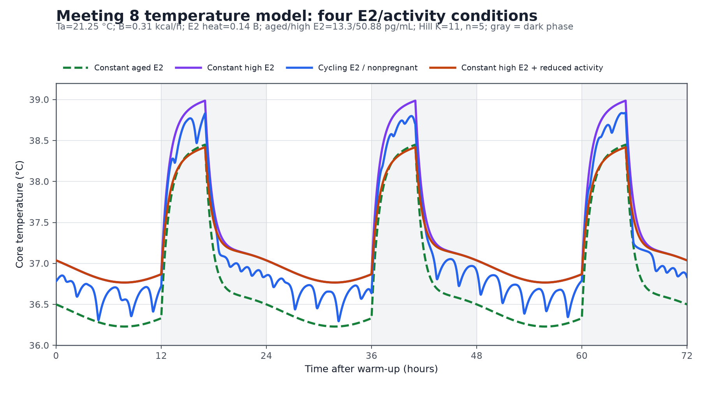
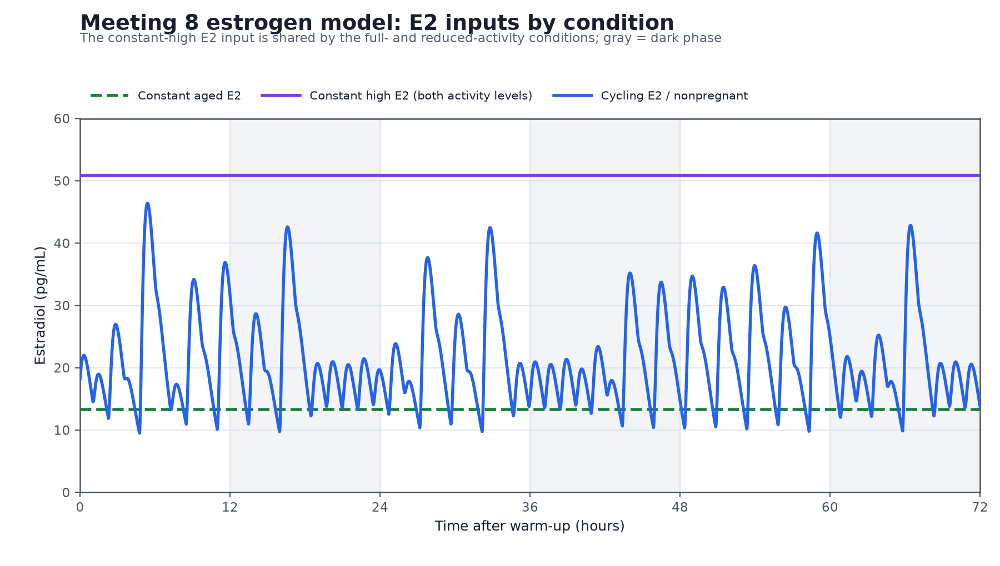
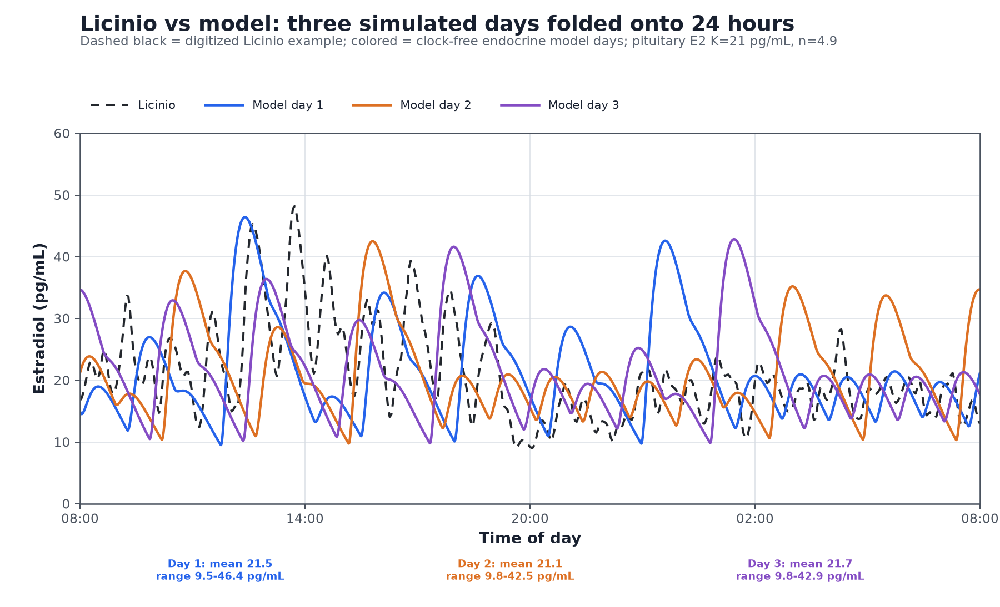

# Meeting 8 final E2 thermogenesis-temperature model

`MODEL.py` is the self-contained Meeting 8 model. It uses a simplified
five-state endocrine driver and the retained temperature equations, with the
thermal E2 Hill gate

```text
K = 11 pg/mL
n = 5
```

the saved model specification.

The Meeting 8 HPG subsystem uses two direct decreasing E2 responses: one sets
the KNDy/N target and one modulates pituitary GnRH-to-LH gain. The pituitary
half-saturation is constrained to the `21-58 pg/mL` Shaw interval and refits to
`21 pg/mL`. Both expressions use current E2 directly: there is no E2 average,
delay, helper response, additional state, or circadian term in the endocrine
amplitude pathway. All endocrine Hill exponents are at most `4.9`.

The solver returns four 72-hour core-temperature series after a 96-hour
warm-up:

1. cycling E2 / nonpregnant;
2. constant aged-female E2 (`13.3 pg/mL`) with nonpregnant inputs;
3. constant-high E2 (`50.88 pg/mL`) with nonpregnant inputs; and
4. constant-high E2 (`50.88 pg/mL`) with reduced activity.

The reduced-activity comparison has no condition-specific basal-heat or SCN
term, and the model has no E2-dependent whole-body conductance/CVC term.

## Final temperature equation

Let

```text
T    = core temperature (degrees C)
Ta   = ambient temperature = 21.25 degrees C
Cb   = whole-body heat capacity = 0.018265662 kcal/degrees C
B    = calibrated OVX background heat = 0.31 kcal/h
G    = whole-body conductance = 0.022504398813 kcal/(h degrees C)
kappa = G/Cb = 1.232060399 h^-1
```

The E2 thermogenesis gate is

```text
H_E2(E2) = E2^5 / (11^5 + E2^5).
```

The temperature model is

```text
dT/dt = B/Cb
      + (0.14 B/Cb) H_E2(E2)
      + kappa (0.19 degrees C) SCN(ZT)
      + kappa m_A (1.9 degrees C) Activity(ZT)
      - kappa (T - Ta).
```

The equivalent heat-flow form is

```text
Cb dT/dt = B + 0.14 B H_E2(E2)
          + G[0.19 SCN + 1.9 m_A Activity]
          - G(T - Ta).
```

The appearances of `G` in the SCN and activity terms are dimensional
conversions from temperature-equivalent inputs into heat flow. They do not
assert that these inputs act biologically by changing conductance.

### SCN and activity inputs

```text
SCN(ZT) = -cos[2 pi (ZT - 7)/24]

Activity(ZT) = 1,  12 <= ZT < 17
Activity(ZT) = 0,  otherwise.
```

The SCN drive is `-1` at ZT7 and `+1` at ZT19. This sign represents the
hypothermic light-phase influence of SCN vasopressin output rather than a
negative neural firing rate.

The `0.19 degrees C` coefficient assigns half of Scheer et al.'s measured
`0.38 degrees C` activity-independent subjective day-night resting-temperature
contrast to each side of the 24-hour-average background term: `-0.19 degrees C`
at the modeled daytime trough and `+0.19 degrees C` at the modeled nighttime
peak. Scheer measured freely moving male Wistar rats under constant darkness
and calculated resting temperature only after at least 32 minutes without
detected locomotor activity; complete SCN lesions abolished the endogenous
temperature rhythm. This makes the anchor independent of nocturnal activity
and ovarian E2 cycling. It is not an estrogen-null experiment, and the reported
`0.38 degrees C` is a phase-average contrast rather than a directly measured
peak-trough amplitude. The symmetric `+/-0.19 degrees C` interpretation is
therefore an explicit, conservative modeling allocation.

### Condition-specific inputs

| Condition | E2 input | `m_A` |
|---|---:|---:|
| Cycling E2 / nonpregnant | Dynamic endocrine output | 1.0 |
| Constant aged E2 | 13.3 pg/mL | 1.0 |
| Constant high E2 | 50.88 pg/mL | 1.0 |
| Constant high E2 + reduced activity | 50.88 pg/mL | 0.70 |

## What K=11 and n=5 do

At the E2 concentrations that matter most in this model:

| E2 input | `H_E2(E2)` |
|---:|---:|
| Cycling minimum, 9.517890 pg/mL | 0.3266 |
| Aged-female comparison, 13.3 pg/mL | 0.7210 |
| Constant high, 50.88 pg/mL | 0.9995 |

The cycling trajectory therefore loses substantially more E2-associated heat
input at its trough than the aged and high constant-E2 conditions. Constant
E2 primarily fills in the trough rather than producing a large upward
displacement of the peak.

`K=11 pg/mL` and `n=5` are waveform-calibration choices. They are not a
measured thermal EC50 or an ER-alpha binding/cooperativity measurement. `K`
lies between the cycling trough and the fixed aged-female E2 input and near the
low end of the `8.3-39.1 pg/mL` serum-E2 interval bracketed by the two groups
in Camporez et al.

## Endocrine E2 driver

The cycling E2 input is generated by five dynamic quantities: aggregate
KNDy/kisspeptin pulse drive `N`, the pulse counter `phi`, GnRH, LH, and E2.
There is one E2 state. There are no separate clock, amplitude-response, or
period-response states.

### Neuropeptide feedback ODE

`N` is expressed on a `0-100` scale. Its decreasing E2-controlled target is

```text
dN/dt = (1.85 h^-1)
        {100/[1 + (E2/5.6)^4.6] - N}.
```

The half-response, exponent, and turnover rate are waveform-calibration
constants rather than receptor measurements. The `4.6` exponent is below the
specified ceiling of `5`. KNDy neurons are experimentally supported as a
synchronized episodic pulse-generator population and as a target of gonadal-
steroid feedback; the numerical concentration-response shape is not claimed
as measured cooperativity.

### GnRH pulse amplitude and period

At a pulse time `t_j`, GnRH receives an instantaneous jump of

```text
A_j = 102.4 [3.5 N_j/(11.3 + N_j)].
```

This is the whole GnRH amplitude equation. The factor `102.4` is constant, not
a clock signal. There is no `ZT`, cosine, maximum function, absolute value, or
piecewise circadian rule. There is no additive amplitude floor: `A_j=0` when
`N=0`. Current E2 separately changes the pituitary response to the pulse.

The pulse period decreases directly with aggregate KNDy/kisspeptin drive:

```text
P_j = 75
      - 24 N_j^1.1/(45^1.1 + N_j^1.1) min.
```

There is no separate period Hill state. Stronger aggregate KNDy/kisspeptin
drive directly shortens the pulse period from `75` minutes toward `51`
minutes. These previously specified endpoints were not refitted. Because the
retained trajectory stays at low `N`, its realized intervals are
`74.5-75.0 min` (mean `74.75 min`), overlapping Licinio et al.'s
`75 +/- 7`-minute daytime LH interval. No day-night frequency rule is imposed.

The earlier pulse-clock counter is retained:

```text
phi_new = phi + dt_min/P_j
pulse fires when floor(phi_new) > floor(phi)
```

Here `phi` is simply the accumulated number of pulse cycles; every integer
crossing generates one GnRH pulse.

### Deterministic pulse timing

The endocrine driver contains no random-number generator and no stochastic
timing or amplitude multipliers. Each pulse period is determined only by the
current aggregate KNDy/kisspeptin drive, and each pulse amplitude is determined
only by aggregate KNDy/kisspeptin drive. The LH amplitude produced by a pulse is
further modulated by current E2 at the pituitary. Day-to-day differences can
therefore arise from the evolving hormone states and pulse-counter phase, but
not from a 24-hour endocrine amplitude envelope.

### Hormone cascade

Between pulses,

```text
dGnRH/dt = -k_GnRH GnRH
dLH/dt   = G_LH,max S_pit(E2) GnRH - k_LH LH
dE2/dt   = 2.5 LH - k_E2 E2.
```

The N feedback response and independently constrained pituitary response are

```text
F_N(E2) = 5.6^4.6/(5.6^4.6 + E2^4.6)

S_pit(E2) = 1 - 0.2 E2^4.9/(21^4.9 + E2^4.9)

G_LH,max = 13.4.
```

These expressions are written directly in the endocrine integration loop.
There is no feedback helper function, clipping `max` operation, averaged E2
quantity, delay, or additional response state.

The pituitary term is the conventional inhibitory-Emax Hill form: sensitivity
is `1` in the absence of E2, equals `0.9` at `21 pg/mL`, and approaches `0.8`
at saturating E2. Across the retained cycling trajectory it spans
`0.8040-0.9959`. The `20%` ceiling remains fixed to the conservative
literature-scale choice; only its half-saturation and sub-5 shape were fitted.

The former `13 + 7 cos(...)` endocrine amplitude envelope was removed before
this constants-only retune. The hormone half-lives and model equations were
held fixed. No E2 average, delay, helper response, basal E2 source, stochastic
term, or new state was added. The later-day attenuation instead emerges from
the existing E2-to-`N` feedback, the existing `N`-dependent pulse amplitude,
and direct E2 modulation of pituitary GnRH-to-LH gain.

In the 72-hour window aligned to the Licinio graph, the production model has
E2 minimum/mean/maximum `9.518/21.436/46.422 pg/mL`, compared with the
digitized target's `9.022/21.053/48.192 pg/mL`. Folded three-hour-bin mean and
within-bin-standard-deviation RMSEs are `3.518` and `2.902 pg/mL`. The
first/second 12-hour model means are `22.666/20.206 pg/mL`, so the refit keeps
the target direction (`25.127/16.994 pg/mL`) but only part of its day-night
separation.

The fit is to the folded envelope and distribution, not exact pulse phase.
Mean daily pointwise RMSE is `9.970 pg/mL`. Large late-half waves remain on
some deterministic model days, especially day 3; this is the main residual
misfit under the no-clock, no-delay, constants-only, Hill-at-most-5
constraints. The model should therefore be described as Licinio-like rather
than as a pointwise reconstruction.

The pituitary midpoint was profiled at every integer from `21` through
`58 pg/mL` while the unanchored constants were refitted. `K=21 pg/mL` gave the
lowest folded-envelope objective. Because the pituitary ceiling is only `20%`,
this profile is substantially less identifiable than the overall E2 range and
mean; `21 pg/mL` should be treated as the best constrained calibration, not a
biological EC50 estimate.

The comparison target is the plotted representative trace for Licinio subject
2, whose reported mean E2 fell from `24.7 +/- 0.9 pg/mL` during 08:00-20:00 to
`16.8 +/- 0.4 pg/mL` during 20:00-08:00. It must not be interpreted as a
universal circadian E2 law: among the six women, two had lower and two had
higher nighttime mean E2, group E2 pulse properties did not show a consistent
day-night change, and the study found no significant LH-E2 cross-correlation.
The model therefore matches an individual waveform phenotype using endocrine
feedback dynamics; it does not assert a population-level E2 clock mechanism.

The rounded `20%` ceiling is a conservative literature-scale calibration
choice, not a human pituitary dose-response fit. Shaw et al. isolated a direct suppressive
pituitary effect by blocking endogenous GnRH and administering the same graded
GnRH challenges before and after one month of estrogen. LH response decreased
by 26% and 23% at the two doses quantified in the Results. Mean E2 increased
from approximately 19-20 pg/mL at baseline to 58-80 pg/mL with treatment. This
supports the sign and approximate scale of the modeled effect, but not an
instantaneous response to each E2 fluctuation. The fitted pituitary midpoint
is `21 pg/mL`, the lower edge of the user-specified `21-58 pg/mL` interval,
and the fitted exponent is `4.9`. Neither value is a measured gonadotroph
dose-response parameter. The term is a compact representation of direct
negative feedback during ordinary pulsatile operation, not the separate
positive-feedback mechanism required for the preovulatory surge.

Shorter-timescale evidence supports using this response as an hourly-scale
quasi-steady approximation, while not proving an instantaneous human
concentration-response curve. Yen et al. found that a four-hour E2 infusion
rapidly suppressed and largely abolished pulsatile LH release in women with
gonadal dysgenesis, but that whole-axis experiment did not isolate the
pituitary. Moll and Rosenfield isolated rat anterior pituitaries and applied
controlled GnRH pulses; E2 significantly reduced the LH response within 36
minutes, to a pulse-response ratio of `0.80 +/- 0.05`. Araki et al. found a
reduced human pituitary response to the same exogenous GnRH challenge after
24 hours of E2 exposure in the early follicular phase, followed by the
expected transition toward positive feedback with longer exposure. Thus the
rapid direct mechanism has strong experimental support, but the cleanest
hourly direct evidence is ex vivo and nonhuman.

The first-order decay constants are calculated from half-lives:

```text
k_GnRH = ln(2)/(4/60 h)  = 10.397207708 h^-1
k_LH   = ln(2)/(20/60 h) =  2.079441542 h^-1
k_E2   = ln(2)/(30/60 h) =  1.386294361 h^-1.
```

## Constant provenance

The constants are separated below into direct experimental anchors, derived
quantities, figure-informed calibrations, and explicit model choices. They
should not all be described as values "taken from the literature."

### Thermal constants

| Constant | Value | Type | Provenance and interpretation |
|---|---:|---|---|
| Ambient temperature `Ta` | 21.25 degrees C | Uncertainty-consistent calibration | Selected within the `22 +/- 1 degrees C` housing interval reported by Jin et al. to align the modeled absolute temperature level with the digitized nonpregnant trace. It is not claimed as Jin et al.'s exact room setpoint. |
| Initial temperature | 37 degrees C | Numerical initial condition | Used only to start the four-day warm-up; it does not prescribe the retained orbit. |
| Heat capacity `Cb` | 0.018265662 kcal/degrees C | Figure-derived calculation | Calculated from the approximately `22.36 g` body mass and `3.98 g` whole-body fat mass of the short-term WT-OVX group digitized from Zengin et al. Figure 1b-c, using the Abreu-Vieira mouse heat-capacity approximation. The Zengin values are plotted group means, not tabulated measurements. |
| OVX background heat `B` | 0.31 kcal/h | Uncertainty-consistent calibration | Selected within the displayed uncertainty around the approximately `0.32 kcal/h` short-term WT-OVX value in Zengin et al. Figure 5A. It is not claimed as the reported group mean or as classical postabsorptive thermoneutral BMR. |
| Whole-body conductance `G` | 0.022504398813 kcal/(h degrees C) | Cross-study scaling | The `0.0255 kcal/(h degrees C)` Abreu-Vieira estimate in 26.97-g male C57BL/6J mice is scaled by `(22.36/26.97)^(2/3)` to the digitized Zengin short-term WT-OVX body mass. Zengin did not measure conductance, so only the target mass comes from that study. |
| Maximum E2 thermogenesis | `0.14 B` | Upper-end figure-derived effect-size calibration | Selected at the upper end of the approximately `10-14%` mouse whole-body heat difference supported by the Camporez et al. cross-check. The approximately `11%` rat central-E2 result from Martinez de Morentin et al. remains a lower supporting anchor. |
| Thermal E2 midpoint `K` | 11 pg/mL | Model calibration | Selected between the cycling trough and 13.3-pg/mL aged input and near the low end of the Camporez serum bracket. It is not an experimental EC50. |
| Thermal E2 Hill exponent `n` | 5 | Model calibration | Produces a steep enough transition to distinguish the cycling trough from constant E2 without materially separating the peaks. It is not measured receptor cooperativity. |
| SCN amplitude | 0.19 degrees C | Literature-derived modeling allocation | Half of the `0.38 degrees C` activity-independent subjective day-night resting-temperature contrast in male rats reported by Scheer et al.; zero-centered because `B` is a 24-hour mean. Scheer reported phase averages, not extrema. |
| SCN neural phase | peak ZT7 | Experimental timing anchor | Thirouin et al. found the female SCN-VP firing acrophase around CT6-8. |
| SCN thermal sign | trough ZT7 | Mechanistic direction | Guzman-Ruiz et al. showed that SCN vasopressin output is hypothermic during the light phase, whereas ARC alpha-MSH supports high nighttime temperature. |
| Activity scale | 1.9 degrees C | Data-derived scale | Difference between `38.1 +/- 0.3 degrees C` including PAEE and `36.2 +/- 0.3 degrees C` after subtracting PAEE in Abreu-Vieira et al. Table 1. |
| Activity schedule | ZT12-17 | Model choice | A five-hour rectangular dark-phase bout. It is not a directly measured activity waveform. |
| Aged E2 input | 13.3 pg/mL | Direct group mean used as comparison | Glassberg et al. measured `13.3 +/- 0.6 pg/mL` in intact 24-month-old female C57BL/6J mice (`n=9`). It is not evidence of a flat within-mouse time series. |
| Constant-high E2 input | 50.88 pg/mL | Model comparison input | Retained from the earlier waveform calibration as a fixed comparison level; it is not a measured gestational serum concentration or the maximum of the current cycling trace. |
| Reduced-activity multiplier | 0.70 | Conservative model choice | Retains 70% of modeled activity heat. Ladyman et al. report about a 50% early-pregnancy reduction in voluntary wheel running; Clarke et al. report about a 70% reduction in total activity, especially in the dark phase. Measured movement is not converted one-to-one into heat. |

### Zengin-matched heat-capacity calculation

Zengin et al. Figure 1b-c plots the short-term WT-OVX group at approximately
`22.36 g` total body mass and `3.98 g` whole-body fat mass. These are digitized
group means, and the figure caption reports `8-11` mice per group. The paper
does not provide the exact values in a table. Using the Abreu-Vieira
approximation:

```text
M   = 22.36 g
F   = 3.98 g
f   = F/M = 3.98/22.36 = 0.177996
cp  = 0.9100 - 0.5231 f
    = 0.816890 cal/(g degrees C)

Cb  = cp x 22.36 g
    = 18.265662 cal/degrees C
    = 0.018265662 kcal/degrees C.
```

This aligns the heat-capacity reference with the Zengin group used to anchor
`B`. It does not make `B` a raw rate from a 22.36-g individual: Zengin Figure
5A presents resting metabolic rate after ANCOVA adjustment to a common
short-term lean mass of `15.34 g`.

### Zengin-mass conductance calculation

Zengin did not measure whole-body conductance. The model therefore retains
the Abreu-Vieira conductance anchor but transfers it to the same 22.36-g
Zengin reference mass using approximate body-surface-area scaling:

```text
Gref = 0.0255 kcal/(h degrees C) at Mref = 26.97 g

G = Gref x (M/Mref)^(2/3)
  = 0.0255 x (22.36/26.97)^(2/3)
  = 0.022504398813 kcal/(h degrees C).
```

Thus `Cb` uses both Zengin body mass and fat mass, whereas `G` uses the Zengin
body mass but remains a cross-study estimate rather than a Zengin measurement.

### Selection of the 0.31-kcal/h background heat

Zengin et al. Figure 5A places the short-term WT-OVX resting-metabolic-rate
bar at approximately `0.32 kcal/h`, with `8-11` mice per group and an SEM bar
that includes `0.31 kcal/h`. The model therefore uses

```text
B = 0.31 kcal/h.
```

This is an uncertainty-consistent calibration near the measured group result,
not a claim that Zengin reported a group mean of exactly `0.31`. Their Figure
5A value is also ANCOVA-adjusted to a common short-term lean mass of `15.34 g`;
it is not a raw rate for an individual 22.36-g mouse. Plausible values in the
approximately `0.31-0.33 kcal/h` range mainly shift the absolute temperature
level. In this revision `B` is held fixed at `0.31 kcal/h`.

### The 0.14 E2 thermogenesis ceiling

Martinez de Morentin et al. Figure 3D gives approximate 72-hour total-energy-
expenditure bars of

```text
vehicle total EE about 2.60 kcal/(g lean mass x 72 h)
E2 total EE      about 2.89 kcal/(g lean mass x 72 h)

(2.89 - 2.60)/2.60 = 0.1115.
```

This was pharmacological intracerebroventricular E2 in rats, so the
approximately `0.11` effect is a supporting lower anchor rather than a mouse
serum concentration-response coefficient.

Camporez et al. supplies a mouse whole-body plausibility check. Their groups
had serum E2 of approximately `8.3` and `39.1 pg/mL`. Back-converting the
mass-normalized heat values in Figure 1C gives an approximate 10-14% increase
in whole-animal heat. The model uses the upper end, `0.14 B`, to retain a
literature-supported larger separation between cycling-trough and constant
aged E2 while keeping `n=5` and the aged input at `13.3 pg/mL`. This
cross-check does not identify `K` or `n`, because the study contains group
comparisons rather than a concentration-response curve.

### Endocrine constants

| Constant | Value | Provenance |
|---|---:|---|
| GnRH half-life | 4 min | Literature-scale kinetic anchor; consistent with the commonly reported rapid 2-4-min GnRH half-life. |
| LH half-life | 20 min | Literature-scale kinetic anchor for the rapid component of LH clearance. |
| E2 half-life | 30 min | Rounded from the `27.45 +/- 5.65 min` terminal half-life reported by White et al. after intravenous estradiol in women; not a direct mouse ovarian-clearance measurement. |
| Maximum GnRH-to-LH gain `G_LH,max` | 13.4 | Constants-only Licinio subject-2 waveform calibration. |
| E2 gain | 2.5 | Licinio waveform calibration. |
| Neuropeptide turnover rate `k_N` | 1.85 h^-1 | Constants-only Licinio waveform calibration. |
| Maximum KNDy/kisspeptin drive `N_max` | 100 | Scale definition for `N`. |
| E2-to-neuropeptide half-response `K_N` | 5.6 pg/mL | Licinio waveform calibration; it is not a measured receptor EC50. |
| E2-to-neuropeptide effective Hill slope `h_N` | 4.6 | Phenomenological population-transition calibration; below the imposed ceiling of 5. |
| KNDy-dependent amplitude coefficient | 3.5 | Licinio waveform calibration; pulse amplitude is zero when `N = 0`. |
| Pulse-amplitude response midpoint | 11.3 on the 0-100 N scale | Licinio subject-2 waveform calibration. |
| Pulse-period response midpoint | 45.0 on the 0-100 N scale | Licinio subject-2 waveform calibration. |
| Pulse-amplitude exponent | 1.0 | Phenomenological synchronized-population response calibration. |
| Pulse-period response exponent | 1.1 | Phenomenological period-response calibration. |
| Minimum/maximum pulse period | 51/75 min | Previously specified Meeting 8 bounds; held fixed. Realized `74.5-75.0 min` intervals overlap Licinio's `75 +/- 7 min` daytime LH interval. |
| Constant GnRH pulse scale | 102.4 | Clock-free Licinio calibration. This constant multiplier has no Zeitgeber-time dependence. |
| Pituitary E2 inhibition ceiling | 0.2 | Conservative rounded approximation to the approximately 23-26% reductions in LH responses to controlled GnRH challenges reported by Shaw et al.; it is not an instantaneous dose-response estimate. |
| Pituitary E2 half-saturation | 21 pg/mL | Best profiled fit within the user-specified `21-58 pg/mL` Shaw interval; not a measured gonadotroph EC50. |
| Pituitary E2 Hill exponent | 4.9 | Constants-only waveform calibration; below the imposed ceiling of 5. |

The endocrine half-lives remain fixed at their literature-scale values, and
the differential equations are unchanged. Only existing constants were
retuned. The pulse-period endpoints are anchored to the scale of Licinio's
reported human LH intervals; the direct pituitary ceiling is anchored to
Shaw et al.; and the remaining fitted values were calibrated to the frequently
sampled Licinio subject-2 waveform. The endocrine amplitude clock factor remains
absent. The fitted slopes, gains, and midpoints are phenomenological
calibration parameters rather than independent biological measurements.

### Numerical constants and initial conditions

| Quantity | Value | Role |
|---|---:|---|
| Integration step | `1/600 h = 6 s` | Shared explicit-Euler step for endocrine and temperature subsystems. |
| Warm-up | 96 h | Four complete ZT cycles discarded before output. |
| Returned output | 72 h | Three complete ZT cycles, beginning at ZT0. |
| Light/dark schedule | ZT0-12 / ZT12-24 | Shared 12:12 Zeitgeber clock. |
| Initial GnRH | 0 | Warm-up initial condition. |
| Initial LH | 5 | Warm-up initial condition. |
| Initial E2 | 15 pg/mL | Warm-up initial condition. |
| Initial `N` | E2-feedback steady-state value at 15 pg/mL | Warm-up initial condition. |
| Initial temperature | 37 degrees C | Warm-up initial condition for every thermal condition. |

## Derived thermal coefficients

`MODEL.py` evaluates

| Derived quantity | Calculation | Value |
|---|---|---:|
| Thermal rate constant | `G/Cb` | 1.232060399 h^-1 |
| Basal temperature rate | `B/Cb` | 16.971736365 degrees C/h |
| Maximum E2 heat rate | `0.14 B/Cb` | 2.376043091 degrees C/h |
| SCN rate amplitude | `kappa x 0.19` | 0.234091476 degrees C/h |
| Full activity rate | `kappa x 1.9` | 2.340914758 degrees C/h |
| Background-only equilibrium | `Ta + B/G` | 35.025085 degrees C |

The background-only equilibrium is not intended to reproduce complete core
temperature: E2, SCN, and activity are explicit additional inputs.

## Why there is no E2 conductance/CVC term

An earlier model draft used an E2-dependent reduction in whole-body heat loss.
It was removed because:

- Dacks and Rance measured rat tail heat-loss index rather than whole-body
  conductance. Their large differences were not measured at the model's
  `21.25 degrees C` ambient value.
- Marui et al. directly calculated whole-body conductance and reported no
  significant OVX versus OVX+E2 difference within the light or dark phase at
  the tested temperatures.
- The removed coefficient changed whole-body conductance by at most 2.75% and
  had negligible influence on the waveform being modeled.

This does not mean E2 has no effect on cutaneous vasomotion. It means the
available evidence does not identify a defensible quantitative E2 multiplier
on whole-body conductance near room temperature for this reduced model. The detailed
evidence audit is in `E2_heat_loss_tail_temperature_research_memo.md` and
`E2_non_CVC_heat_loss_at_22C_literature_review.md`.

## Final simulated behavior

Using the six-second Euler step, 96-hour warm-up, and 72 retained hours:

Across the Licinio-aligned retained 72 h, the cycling endocrine driver has
`14`, `15`, and `13` visible E2 maxima on successive days, an E2 range of
`9.518-46.422 pg/mL`, and a mean of `21.436 pg/mL`. Its `58` scheduled GnRH
pulse events have realized intervals of `74.5-75.0 min` (mean `74.75 min`).
Because the amplitude has no additive floor, events occurring near `N = 0`
can be physiologically negligible. These counts describe local maxima of the
deterministic model trace and should not be equated with the statistically
significant E2 pulses reported by Licinio et al.

| Condition | Mean (degrees C) | Minimum (degrees C) | Maximum (degrees C) | Peak-trough range (degrees C) |
|---|---:|---:|---:|---:|
| Cycling E2 / nonpregnant | 37.1554 | 36.2942 | 38.8374 | 2.5432 |
| Constant aged E2, 13.3 pg/mL | 36.8113 | 36.2297 | 38.4496 | 2.2200 |
| Constant high E2, 50.88 pg/mL | 37.3485 | 36.7668 | 38.9868 | 2.2200 |
| Constant high E2 + reduced activity | 37.2298 | 36.7668 | 38.4180 | 1.6512 |

Relative to cycling E2:

- the constant aged-E2 trough is `0.0645 degrees C` lower and its peak is
  `0.3878 degrees C` lower;
- the constant-high-E2 trough is `0.4726 degrees C` higher and its peak is
  `0.1494 degrees C` higher; and
- the constant-high-E2 + reduced-activity trough is `0.4726 degrees C`
  higher and its peak is `0.4194 degrees C` lower.

The reduced-activity comparison retains 70% of the modeled activity input. No
condition-specific basal-heat or SCN term is added.

### Temperature time series



### Estradiol time series

The full-activity and reduced-activity high-E2 conditions share the same
constant E2 input, so their single overlapping line is labeled for both.



### Licinio subject-2 folded comparison

The black dashed line is the digitized representative Licinio trace. The three
colored lines are successive model days folded onto the same 08:00-08:00
axis. The comparison shows the retained Licinio-like concentration range and
folded envelope, along with the residual late-half waves that the constrained
clock-free refit does not eliminate.



## References

- Abreu-Vieira et al. (2015), *Integration of body temperature into the
  analysis of energy expenditure in the mouse*.
  [DOI](https://doi.org/10.1016/j.molmet.2015.03.001) ·
  [full text](https://pmc.ncbi.nlm.nih.gov/articles/PMC4443293/)
- Camporez et al. (2013), *Cellular Mechanism by Which Estradiol Protects
  Female Ovariectomized Mice From High-Fat Diet-Induced Hepatic and Muscle
  Insulin Resistance*.
  [DOI](https://doi.org/10.1210/en.2012-1989) ·
  [full text](https://pmc.ncbi.nlm.nih.gov/articles/PMC3578999/)
- Clarke et al. (2024), *Circadian patterns of behaviour change during
  pregnancy in mice*.
  [DOI](https://doi.org/10.1113/JP285553) ·
  [full text](https://pmc.ncbi.nlm.nih.gov/articles/PMC11607885/)
- Dacks and Rance (2010), *Effects of Estradiol on the Thermoneutral Zone and
  Core Temperature in Ovariectomized Rats*.
  [DOI](https://doi.org/10.1210/en.2009-1112) ·
  [full text](https://pmc.ncbi.nlm.nih.gov/articles/PMC2840690/)
- Glassberg et al. (2014), *17beta-Estradiol Replacement Reverses Age-Related
  Lung Disease in Estrogen-Deficient C57BL/6J Mice*.
  [DOI](https://doi.org/10.1210/en.2013-1345) ·
  [full text](https://pmc.ncbi.nlm.nih.gov/articles/PMC3891937/)
- Guzman-Ruiz et al. (2015), *Role of the Suprachiasmatic and Arcuate Nuclei
  in Diurnal Temperature Regulation in the Rat*.
  [DOI](https://doi.org/10.1523/JNEUROSCI.1449-15.2015) ·
  [full text](https://pmc.ncbi.nlm.nih.gov/articles/PMC6605483/)
- Jin et al. (2025), *Effects of Vitamin E Intake and Voluntary Wheel Running
  on Whole-Body and Skeletal Muscle Metabolism in Ovariectomized Mice*.
  [DOI](https://doi.org/10.3390/nu17060991) ·
  [full text](https://pmc.ncbi.nlm.nih.gov/articles/PMC11944365/)
- Ladyman et al. (2021), *A reduction in voluntary physical activity in early
  pregnancy in mice is mediated by prolactin*.
  [DOI](https://doi.org/10.7554/eLife.62260) ·
  [full text](https://pmc.ncbi.nlm.nih.gov/articles/PMC8480982/)
- Licinio et al. (1998), *Synchronicity of frequently sampled, 24-h
  concentrations of circulating leptin, luteinizing hormone, and estradiol in
  healthy women*. The study sampled women every seven minutes on cycle days
  8-11. The plotted representative subject-2 trace supplies the waveform
  target; the six-subject results do not establish a universal circadian E2
  amplitude pattern.
  [DOI](https://doi.org/10.1073/pnas.95.5.2541) ·
  [full text](https://pmc.ncbi.nlm.nih.gov/articles/PMC19406/)
- Wakabayashi et al. (2013), *Electrophysiological and Morphological Evidence
  for Synchronized GnRH Pulse Generator Activity Among
  Kisspeptin/Neurokinin B/Dynorphin A (KNDy) Neurons in Goats*. This supports
  treating `N` as an aggregate synchronized pulse-generator drive and reports
  reduced pulse-generator volley frequency with E2 administration; it does
  not identify the fitted Hill slopes used here.
  [full text](https://pmc.ncbi.nlm.nih.gov/articles/PMC3943231/)
- Shaw et al. (2010), *Estrogen Negative Feedback on Gonadotropin Secretion:
  Evidence for a Direct Pituitary Effect in Women*. Endogenous GnRH was
  suppressed and the same graded GnRH challenge was compared before and after
  one month of estradiol administration to isolate pituitary responsiveness;
  LH responses were reduced by approximately 23-26% at the two doses
  quantified in the Results.
  [DOI](https://doi.org/10.1210/jc.2009-2108) ·
  [full text](https://pmc.ncbi.nlm.nih.gov/articles/PMC2853991/)
- Yen et al. (1972), *Gonadotropin Dynamics in Patients with Gonadal
  Dysgenesis: A Model for the Study of Gonadotropin Regulation*. A four-hour
  E2 infusion rapidly suppressed pulsatile LH release in humans, although the
  experiment did not isolate pituitary from hypothalamic action.
  [DOI](https://doi.org/10.1210/jcem-35-6-897)
- Moll and Rosenfield (1984), *Direct Inhibitory Effect of Estradiol on
  Pituitary Luteinizing Hormone Responsiveness to Luteinizing Hormone
  Releasing Hormone Is Specific and of Rapid Onset*. In isolated rat anterior
  pituitary, E2 reduced the response to a controlled GnRH pulse within 36
  minutes, providing the closest rapid mechanistic analogue to `S_pit(E2)`.
  [DOI](https://doi.org/10.1095/biolreprod30.1.59)
- Araki et al. (1980), *Further Analysis of the Positive Feedback Effects of
  Estrogen on the Release of Gonadotropin in Women*. The pituitary response to
  exogenous GnRH was reduced after 24 hours of E2 in early-follicular women,
  before transitioning toward positive feedback with longer exposure.
  [DOI](https://doi.org/10.1507/endocrj1954.27.709)
- Veldhuis et al. (1987), *Actions of Estradiol on Discrete Attributes of the
  Luteinizing Hormone Pulse Signal in Man: Studies in Postmenopausal Women
  Treated with Pure Estradiol*. The response was exposure-dependent and
  biphasic rather than a single time-invariant effect.
  [DOI](https://doi.org/10.1172/JCI112883)
- Filicori et al. (1986), *Characterization of the physiological pattern of
  episodic gonadotropin secretion throughout the human menstrual cycle*.
  [PubMed](https://pubmed.ncbi.nlm.nih.gov/3084534/)
- Reame et al. (1984), *Pulsatile gonadotropin secretion during the human
  menstrual cycle: evidence for altered frequency of gonadotropin-releasing
  hormone secretion*. [PubMed](https://pubmed.ncbi.nlm.nih.gov/6429184/)
- Martinez de Morentin et al. (2014), *Estradiol Regulates Brown Adipose
  Tissue Thermogenesis via Hypothalamic AMPK*.
  [DOI](https://doi.org/10.1016/j.cmet.2014.03.031) ·
  [full text](https://pmc.ncbi.nlm.nih.gov/articles/PMC4082097/)
- Marui et al. (2020), *Influence of exogenous and endogenous estrogen on
  thermoregulatory responses to mild heat and the interaction with light and
  dark phases*.
  [DOI](https://doi.org/10.1186/s12576-020-00782-x) ·
  [full text](https://pmc.ncbi.nlm.nih.gov/articles/PMC10717522/)
- Scheer et al. (2005), *Environmental Light and Suprachiasmatic Nucleus
  Interact in the Regulation of Body Temperature*.
  [DOI](https://doi.org/10.1016/j.neuroscience.2004.12.012) ·
  [PubMed](https://pubmed.ncbi.nlm.nih.gov/15802197/)
- Thirouin et al. (2023), *Sex-specific differences in the circadian pattern
  of action potential firing by rat suprachiasmatic nucleus vasopressin
  neurons*. [DOI](https://doi.org/10.1111/jne.13273)
- White et al. (1998), *The pharmacokinetics of intravenous estradiol--a
  preliminary study*. [PubMed](https://pubmed.ncbi.nlm.nih.gov/9855336/)
- Zengin et al. (2013), *Neuropeptide Y mediates the short-term hypometabolic
  effect of estrogen deficiency in mice*.
  [DOI](https://doi.org/10.1038/ijo.2012.71)

## Running the model

From the `meeting8` directory:

```python
import MODEL

result = MODEL.run()
hours = result["hour"]
cycling_e2 = result["E2_pg_ml"]
cycling_temperature = result["nonpregnant_temperature_c"]
aged_temperature = result["constant_low_temperature_c"]
high_e2_temperature = result["constant_high_temperature_c"]
high_e2_reduced_activity_temperature = result["pregnant_temperature_c"]
```

The `pregnant_*` result keys are retained for compatibility with earlier
Meeting 7/8 scripts; in this version they denote the constant-high-E2 +
reduced-activity comparison.

`MODEL.py` writes no files and requires only NumPy. The `constant_low_*` keys
are retained for compatibility with Meeting 7 but now explicitly represent
the fixed `13.3-pg/mL` aged-female comparison.

To regenerate the temperature, E2, and Licinio-comparison figures:

```text
python PLOT.py
```

`PLOT.py` writes `temperature_timeseries_four_conditions.png`,
`estradiol_timeseries_four_conditions.png`,
and `licinio_three_day_folded_comparison.png` beside the script. It requires
NumPy and Matplotlib.
